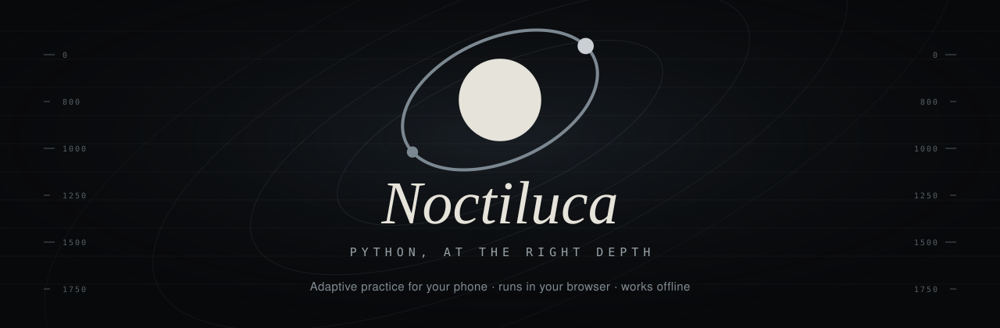
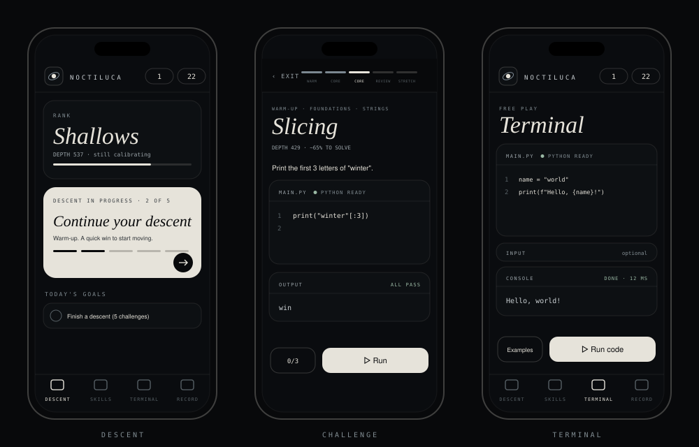
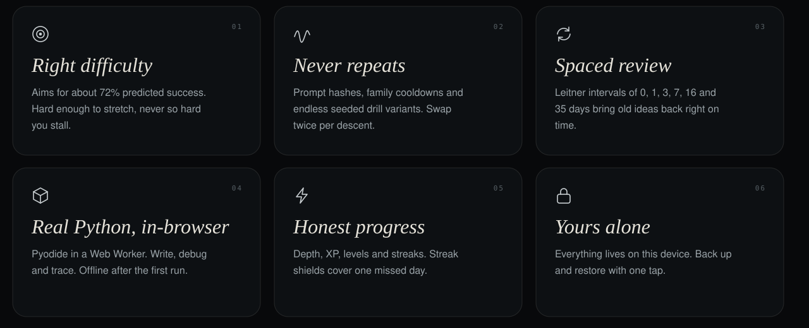
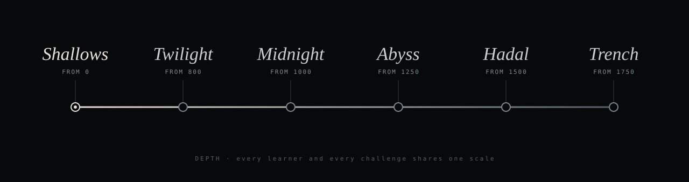
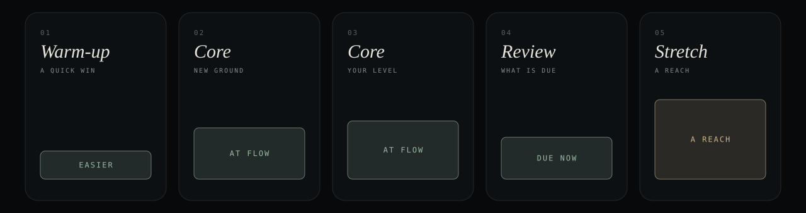
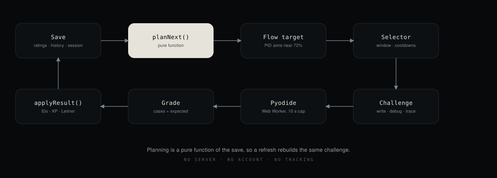
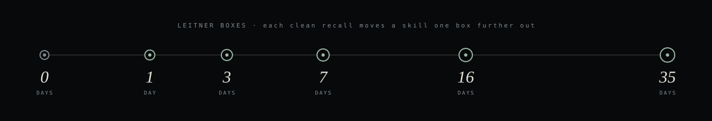
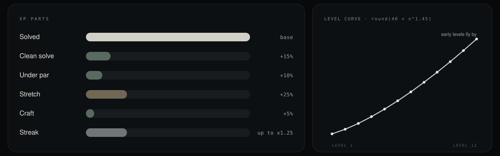
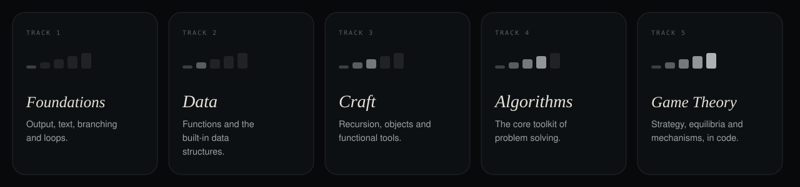
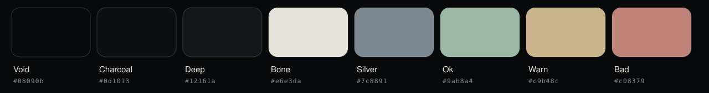

<div align="center">



<br />


<br />


</div>


**Noctiluca** is adaptive Python practice for your phone. Short challenges meet you at your level, never repeat, and slowly deepen. Python runs in your browser (Pyodide in a Web Worker), so it works offline after the first run. There is no server, no account and no tracking.



## Principles



## Depth and ranks

Every learner, every concept and every challenge sits on one **depth** scale. Your rank follows your overall depth, and the **Skills** screen shows depth per concept.



## A descent

One session is a **descent** of five challenges, planned one step at a time. Each slot has a hard difficulty window tied to your recent clean solves, so a new level can never leap far above what you just did.



## How the engine works



| Part | What it does |
| --- | --- |
| **Rating** | Elo style skill per learner and per concept (logistic, 400 scale). Only clean solves give full credit; helped solves give 30 percent. |
| **Flow target** | A PID like controller aims for about 72 percent predicted success (clamped 55 to 90) and gives a breather after struggle. |
| **Session arc** | Warm-up, core, core, review, stretch, planned by the pure function `planNext(save, catalog, now)`. |
| **No sudden jumps** | Each slot has a hard difficulty window tied to recent clean solves. |
| **No repeats** | Prompt hashes, family cooldowns and endless seeded drill variants. Swap a challenge twice per session without penalty. |
| **Craft linter** | Best practice notes for mutable defaults, bare `except`, `range(len(...))` and more. |

### Spaced review



### XP and levels

Solved, clean solve, under par, stretch and craft bonuses, with a streak multiplier up to x1.25. Streak shields cover one missed day.



## Content

**29 concepts** in **5 tracks**, **146 authored challenges** (write, debug, trace) plus **157 seeded drill families**.



Add a challenge in `src/curriculum/*.ts`, then run `npm run verify` to bake its expected output.

## Terminal

A free scratchpad for any Python. Optional `input()` lines, a console, example snippets, and your code is saved on the device. Nothing there changes your depth or XP.

## Install on your phone

Open the site in Safari, tap **Share**, then **Add to Home Screen**. On Android, Chrome offers **Install**. It launches full screen with the Noctiluca icon and no browser bars, and a service worker keeps the app and the Python runtime available offline.

Progress lives in this browser. Use **Record → Backup** to copy a backup before clearing site data or changing phones.

## Quick start

```bash
npm install
npm run dev        # local dev server
npm run verify     # runs every challenge in python3 and bakes expected outputs
npm run simulate   # simulated learners against the engine
npm run build      # type check and build into dist/
npm run assets     # regenerate icons, favicons and iOS splash screens
```

Deploys to GitHub Pages with `.github/workflows/pages.yml` (base path `/`, for the user site `noctilucapy.github.io`).

## Project map

```text
src/
  App.tsx              routes, fixed top bar and tab bar
  screens/             Home, Skills, Play, Terminal, Record, Done, Onboarding
  components/          TabBar, CodeEditor, Sheet, Icon, LogoMark
  engine/              rating, flow, selector, mastery, xp, goals, coach, store
  curriculum/          concepts, openers, algorithms, theory, trace, debug, drills
  python.ts            Pyodide worker client
public/                manifest, service worker, icons, splash screens
scripts/               verify-curriculum, simulate-engine, generate-assets
docs/assets/           README visuals (SVG)
```

## Design language

**Abyssal Liturgy**: near monochrome, with bone as the only true highlight and three muted signal tints for pass, caution and fail.



Type: **Cormorant Garamond** for display, **Jost** for text, **JetBrains Mono** for code and labels.

## Ethics

The engagement techniques here are honest ones: visible progress, fair difficulty, spaced review. No fake scarcity, loss-aversion traps or paid pressure.

## Limits

Expert content tops out around rating 1600. Advanced concepts without drills fall back to recall after 30 days.


<div align="center">
<sub>NOCTILUCA · PYTHON, AT THE RIGHT DEPTH</sub>
</div>
